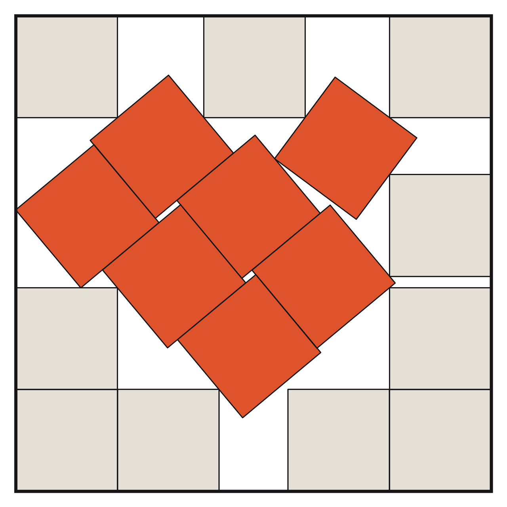

# Seventeen unit squares: verification edition of a candidate proof

Marc Leonard Overbeck (ORCID 0009-0008-8607-8197). Contact: moverbeck@ethz.ch

Version 1 (candidate), 2026-10-12. `CHANGELOG.md` lists the versions.

Seventeen closed unit squares with pairwise disjoint interiors do not fit in a square of side less than L = 4.6755300936..., the side of the packing that John Bidwell found in 1998. This folder holds a candidate proof of that statement and what a reader needs to check it; uniqueness of the packing is not claimed.



`packing.png`: the known packing, drawn from the coordinates in `upper-packing-certificate.json`.

The argument in five steps (each line says what the candidate proof claims; `OVERVIEW.md` gives a paragraph for each):

1. **Upper bound.** The known packing fits in a square of side L: 68 wall conditions and 136 pair conditions, exact.
2. **Capture.** In any packing of side at most C = 4.675531 the seventeen squares can be labelled so that each lies in a named window of positions and directions; this follows from 98 weighted counting certificates, and eleven cases remain.
3. **Admission.** Each of the eleven cases lies in one of eleven explicit regions.
4. **Local trees.** Ten regions contain no packing of side below L; in the eleventh every packing lies in a small tube around the known packing.
5. **Rigidity.** In the tube a finite exact stage and a contraction with ratio below 1 contradict a side below L.

`PROOF.md` at the top level is the proof text. It is a byte copy of `research/finishing-threshold-goal-20261007/current-author-20261012t/fifth-order-20261010/public-edition-round2-20261011/revision-v7/PROOF.md`, placed here so that it is found at once; `check.py` tests that the two files are equal (level 1, `proof-copy`).

## Status

**Candidate proof, not an established theorem.** The project's internal audit covered the sealed record as it stood before the revision that this edition carries. The last step of that revision was editorial: wording, declared extracts, paths with the hashes bound to them, the CPU limits of 4 checks, and the correction of one number in a claim. The producers checked the result by running their 31 checks and their equivalence check in a tree that held only the files of their roster. The revised proof text, the reissued check scripts and the new capture computation have had the checks listed in `AUDIT.md`, but no independent review of the final bytes ("independent" means in this edition: by a separate AI session that had not written what it read; in several places it was a session of the same AI system; `AUDIT.md`). Outside review so far: Guzhou0806 (N17 project) read the fifteen premises in an earlier state of this work and ran a checker of his own on two of the thirteen trees (JQ and JPG15p_v5). His report is not part of this edition. This is not a refereed review, and nobody outside has verified the whole.

## Known issues

Version 1 has known issues: one premise without a separate written proof, about 55 numbers printed without a space in the proof text, records whose status words describe an earlier day, and one tested platform. `KNOWN_ISSUES.md` lists them; version 1.1 is to fix them.

## How to report a problem

This is a candidate proof, released so that others can try to break it. If you find an error, a gap, or a sentence that says more than the files show, please report it: open an issue on the repository (https://github.com/Kleddamag/the-seventeenth-square-candidate/issues), or write to moverbeck@ethz.ch. A report helps most when it names the file, the line and what you expected instead.

Three places deserve the hardest look:

1. The bridge from the class rows to actual packings: `research/finishing-threshold-goal-20261007/current-author-20261012t/fifth-order-20261010/public-edition-round2-20261011/revision-v7/CLASS_ROW_LEMMA.md` (premise CHARGE_SEMANTICS; proof section 3).
2. The root admission geometry (proof section 7), with the rule that the squares it names are distinct (section 4) and the rules for the seams between the cases (section 5).
3. The hand-overs into the final rigidity theorem (proof section 8).

## One command

```
python3 check.py
```

Last line on success: `CHECK RESULT: PASS (levels 0-2; 7118 files, 22013 pins, 41 checks); sha256 of MANIFEST.sha256: <64 hex digits>`. **Compare it with the value in the notes of the release `large-files-v1` of the repository (github.com/Kleddamag/the-seventeenth-square-candidate/releases). The same notes give the SHA-256 of `check.py`.** `MANIFEST.sha256` lists the hash of every file, so this one comparison shows that you hold the edition that was published.

The word after `CHECK RESULT:` is `PASS` only when all three levels and all 41 checks were run and nothing failed. A run of one level or one check, a run without the large files, or a run in which a check was stopped by the CPU limit of its own script, ends `CHECK RESULT: PARTIAL` (exit code 2): nothing that was run failed, but it is not a PASS of the edition. `FAIL` has exit code 1. It takes about 4 minutes on the build machine. It needs Python 3.9 or newer and, for one check, SymPy 1.14.0 (`python3 -m pip install sympy==1.14.0`, or `--sympy-path DIR`); without SymPy the result is FAIL on `endpoint_upper` only. The project ran it on one platform (macOS 27.0.1 (Darwin 27.0.0, arm64), CPython 3.9.6, Node.js v25.6.1, SymPy 1.14.0), and once in full under CPython 3.12.14 on the same machine; other platforms are untested. Details and what a PASS means: `CHECK.md`.

## Licence

No licence for reuse is granted yet. You may download the files and run the checks to verify the result. A licence will be chosen after the first round of review.

## What the statement claims

Line 9 of `STATEMENT.md` says that a packing at side L exists and that no packing has a smaller side. This is the claim that the proof text establishes under its hypotheses: the 210 obligations listed in the producers' file `OBLIGATIONS.json`, of which 15 are mathematical premises. They are the hypotheses of the theorem in the proof text (`revision-v7/PROOF.md`, lines 12 to 14: "Assume the 210 listed obligations ..."). Both files are under `research/finishing-threshold-goal-20261007/current-author-20261012t/fifth-order-20261010/public-edition-round2-20261011/`. The statement is the claim of a candidate proof, not an established theorem. Uniqueness of the packing is not claimed. A premise here is a lemma that the proof text uses. For each one the edition carries the paragraphs of the proof text and the files listed in `PREMISES.md`; for some premises these files are tables and programs only, not a separate written proof. None has been verified by anyone outside the project.

## Who did the work

Marc Leonard Overbeck conceived and led the project: he set the goal, designed how the work was organised and checked, and made the decisions about goal, organisation and release. The mathematics, the engines, the certificates, the checkers, the reviews and the text were produced by AI systems under his direction and to his instructions: Codex (OpenAI) and Claude (Anthropic). They are named and are not authors. `CREDITS.md` says which system did which part, and whose methods the work stands on.

## Next step

A formalization in Lean is planned: a checker whose soundness is proved in Lean, and the certificates of this edition run through it as compiled code. It has not been started. Until it exists and others have checked it, the result is a candidate.

## What this folder is

1. The exact statement is in `STATEMENT.md`; `STATEMENT_STATUS.md` gives its status and its hypotheses. `PREMISES.md` is a table of the fifteen mathematical premises.
2. This folder holds what a reader needs to check the candidate proof: the proof text, the list of its 210 obligations, the certificates, the exact checkers, the stored results of the computations, the review reports of independent readers (separate AI sessions; "Status" above), and one command that checks the folder.
3. The proof text is `PROOF.md` (the copy) and `research/finishing-threshold-goal-20261007/current-author-20261012t/fifth-order-20261010/public-edition-round2-20261011/revision-v7/PROOF.md` (the producers' file). `READING_ORDER.md` says what to read in which order. `OVERVIEW.md` is a one-page summary.
4. The work was produced, read and checked by AI systems under the direction of the project owner. Within the project no human has read the mathematics. `CREDITS.md` says who did what and on whose work this stands; it also says that the AI systems are not authors.
5. One command checks the folder: `python3 check.py` (above). It checks the structure and runs the cheap exact checks. It does not recompute the capture rows or the tree certificates; `CHECK.md` says how to do that by hand.
6. `KNOWN_LIMITS.md` says what this edition does not show and what a reader takes on trust. `AUDIT.md` says what the internal audit covered.
7. This edition is a selection. The project's sealed record (the proof packet as it was frozen for the audit, its later corrections, and the audit trail) and the earlier executions of the capture computation are not in this folder. `KNOWN_LIMITS.md` says how they relate to what is here.

## Layout

Every carried file keeps the path it has in the project's repository, so that the hashes and paths named inside the files stay valid. That is why the paths are long and why some folder names look like working names. The names carry no meaning beyond identifying the file.

| Path | What |
|---|---|
| `README.md`, `STATEMENT.md`, `STATEMENT_STATUS.md`, `OVERVIEW.md`, `PREMISES.md`, `READING_ORDER.md`, `CHECK.md`, `KNOWN_LIMITS.md`, `AUDIT.md`, `CREDITS.md`, `THIRD_PARTY.md`, `KNOWN_ISSUES.md`, `CHANGELOG.md` | the documents written for this edition |
| `PROOF.md` | the proof text: a byte copy of the producers' file `revision-v7/PROOF.md` |
| `packing.png` | a figure of the known packing, drawn from `upper-packing-certificate.json` |
| `CITATION.cff` | how to cite this edition (Citation File Format 1.2.0) |
| `check.py`, `MANIFEST.sha256`, `EDITION_BINDINGS.json`, `LARGE_FILES.tsv`, `fetch_large.py` | the checking command; the list of every file with its SHA-256; the hashes and counts that `check.py` fixes, in machine-readable form; the list of the 12 large files; the script that fetches them |
| `check_comparison_records.py`, `recompute_slice.py` | the test of the records of the comparison with the earlier executions; recomputation of one slice of one capture statement |
| `AGENTS.md` | a three-line marker of the root folder; several check scripts find the root by this file name |
| `research/finishing-threshold-goal-20261007/current-author-20261012t/fifth-order-20261010/public-edition-round2-20261011/` | the producers' packet: proof text, notation, glossary and derivations (`revision-v7/`), `OBLIGATIONS.json`, `DEPENDENCY_GRAPH.json`, the 31 public checks (`runbook_public.json`, `replay_round2.py`, `scripts/`), their roster of every file they bind (`PUBLIC_INPUTS.tsv`, 6,748 files), their list of root files, the manifest and the checksum list of their sealed packet (`PUBLIC_ARTIFACT_ROOTS.json`, `PART2_MANIFEST.json`, `PART2_SHA256SUMS`) and their equivalence files |
| `PATH_NEUTRAL.tsv` | the list of the files of this edition that are carried with one substitution of two strings (`KNOWN_LIMITS.md`) |
| `local-research/claude-20261002/review/public-edition/path-neutral-20261012/files/` | 47 files of the tree work a second time, at the path where the producers' checks read them (`KNOWN_LIMITS.md`) |
| `research/finishing-threshold-goal-20261007/clean-rerun-20261011/current-build-0122/capture/` | the capture computation: for each of the 98 statements the two inputs, the slices of both checkers with the record of each slice run, the two merged receipts, the merge record and the producers' audit record; under `checker_sources/` the two checkers, the launcher, the merge script and the plan |
| `local-research/claude-20261002/rerun-clean-20261011/` | the records of the comparison with the earlier executions (one per statement, and the summary of the final call), with the programs and tables that made them |
| `local-research/claude-20261002/review/public-edition/round5/` | 29 review reports of independent readers and 20 records of the tree work, as reading copies, with further extracts under `extra/`; their hash tables, the tables of their edited lines and the table of the names of the earlier executions are carried at the paths that `READING_ORDER.md`, part 4, names |
| `local-research/claude-20261002/results/` | the 13 tree certificates (most of them large) and the stored outputs of the second and third execution of the tree checkers |
| `research/window-extension-20261008/` | the two exact tree checkers, their specification `SPEC_v3.0.md`, the region files and the acceptance records |
| `independent/endpoint_enclosure/` | a program of an independent reader (a separate AI session) for the tight enclosure of L, with its outputs and a note on the path lines changed for this edition |
| other folders under `research/` and `local-research/` | the remaining evidence that the obligations and the public checks name |
| `upper-packing-certificate.json` | the known packing in rational form |
| `_large/` | not in the git repository: the 12 files above 100 MB (`LARGE_FILES.tsv`) |

## Getting the large files

12 files are larger than 100 MB (4.8 GB together): tree certificates and one result record. They are not in the git repository; they are attached to a release of the repository `Kleddamag/the-seventeenth-square-candidate`. `LARGE_FILES.tsv` lists each with its path, size and SHA-256. `python3 fetch_large.py` downloads them into `_large/` and verifies size and SHA-256 of each; `python3 fetch_large.py --from DIR` takes them from a local folder instead. Without them `check.py` still runs; the checks that need them are then reported as NOT RUN and the result is PARTIAL, not PASS (`CHECK.md`).

## If you cloned this with git

- `.gitattributes` turns off line-ending conversion (`* -text`); the hashes are over the exact bytes.
- Windows: 116 paths have 240 characters or more. Run `git config --global core.longpaths true` before cloning. `check.py` has not been run on Windows (`CHECK.md`).
- `check.py` does not look into the `.git` folder.

<!-- 🐙 -->
